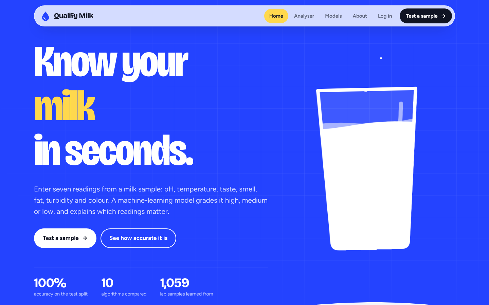
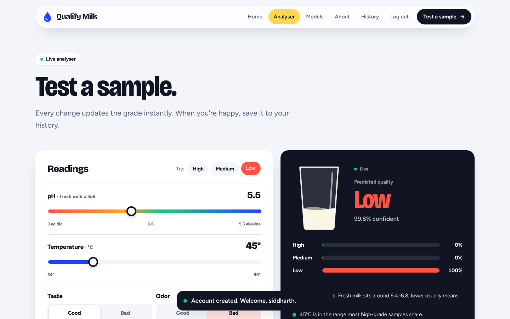
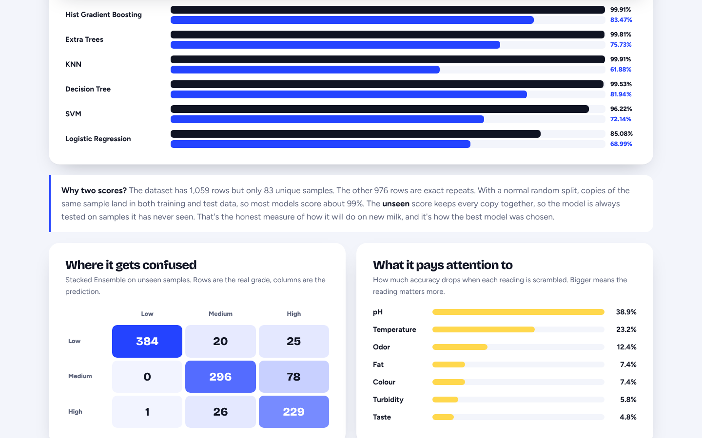

# 🥛 Qualify Milk

**Predict milk quality (high, medium or low) from seven lab readings using machine learning.**

Move the sliders and the grade updates live, with the model's confidence, a probability for each grade, and a plain-language note on every reading that looks off. Results can be saved to your personal history.



| Live analyser | Model comparison |
|---|---|
|  |  |

---

## ✨ Features

- **Live analyser:** pH, temperature and colour sliders plus taste, odor, fat and turbidity toggles. The prediction refreshes as you move them, and an animated glass of milk fills and changes colour with the result.
- **Real dataset samples:** one-click high, medium and low examples taken from the dataset.
- **Explanations:** confidence, per-grade probabilities and a note for each reading (for example, "pH 5.5 is acidic").
- **Prediction history:** save named samples, see totals per grade, delete one or clear all.
- **Model dashboard:** all ten algorithms compared, a confusion matrix, feature importance and a full metrics table (accuracy, precision, recall, F1, ROC-AUC).
- **Accounts:** register and log in with bcrypt-hashed passwords; the analyser and API are login-protected.
- **Polished, responsive UI** that works on phones, is keyboard accessible and respects reduced-motion settings.

---

## 🧠 Machine learning

**Dataset:** `data/milknew.csv` has 1,059 samples with 7 features (pH, Temperature, Taste, Odor, Fat, Turbidity, Colour) and a grade (low 429, medium 374, high 256).

**Important finding:** only **83 rows are unique**; 976 are exact duplicates. With a normal random split, copies of the same sample end up in both training and test sets, so accuracy looks inflated. Every model is therefore scored three ways:

1. **80/20 test split:** the same split as the first version of this project.
2. **Standard CV:** stratified 10-fold cross-validation.
3. **Unseen:** grouped 5-fold CV (averaged over 3 seeds) where every copy of a sample stays in the same fold, so the model is always tested on samples it has never seen. This is the honest measure.

| Model | 80/20 test | Standard CV | Unseen |
|---|---|---|---|
| Stacked Ensemble ⭐ | 100.0% | 99.81% | 86.66% |
| Soft Voting Ensemble | 99.06% | 99.81% | 88.1% |
| Gradient Boosting | 98.58% | 99.81% | 87.0% |
| Random Forest | 99.53% | 99.81% | 84.04% |
| Hist Gradient Boosting | 99.53% | 99.91% | 83.47% |
| Extra Trees | 99.53% | 99.81% | 75.73% |
| KNN | 99.53% | 99.91% | 61.88% |
| Decision Tree | 99.06% | 99.53% | 81.94% |
| SVM | 94.34% | 96.22% | 72.14% |
| Logistic Regression | 83.96% | 85.08% | 68.99% |

**Chosen model: Stacked Ensemble.** It stacks Hist Gradient Boosting, Gradient Boosting, Random Forest and Extra Trees with a Logistic Regression on top. It scores **100%** on the original 80/20 test split (the first version's Random Forest scored 99.53%).

**Improvements over the first version**
- SVM, KNN and Logistic Regression now scale their inputs. SVM went from 56.6% to 94.34% on the test split.
- Added Extra Trees, Gradient Boosting, Hist Gradient Boosting, Soft Voting and Stacking.
- Leak-free evaluation and model selection, as described above.
- Feature importance via permutation: pH and temperature matter most.

Retrain anytime (takes about 4 minutes):

```bash
python ml/train.py
```

This rewrites `ml/milk_model.joblib` and `ml/metrics.json`, and the Models page updates automatically.

---

## 🛠 Tech stack

| Layer | Tech |
|---|---|
| Backend | Python, Flask, Flask-SQLAlchemy, SQLite, bcrypt |
| ML | scikit-learn, pandas, NumPy, joblib |
| Frontend | Jinja templates, hand-written CSS, vanilla JavaScript, animated SVG |

---

## 🚀 Run it

```bash
python -m venv env
env\Scripts\activate          # Windows  (macOS/Linux: source env/bin/activate)
pip install -r requirements.txt
python app.py
```

Open **http://127.0.0.1:5000**, create an account, and open the analyser.

> If the saved model was made with a different scikit-learn version, the app retrains the chosen model automatically on first start (a few seconds).

---

## 📁 Structure

```
Qualify-Milk/
├── app.py                 # Flask app: pages, auth, history, /api/predict
├── data/milknew.csv       # dataset
├── ml/
│   ├── train.py           # trains + compares 10 models, saves the best
│   ├── milk_model.joblib  # trained model
│   ├── metrics.json       # scores shown on the Models page
│   └── original_exploration.ipynb
├── static/
│   ├── css/style.css
│   ├── js/main.js         # animated milk glass, reveals, nav
│   ├── js/analyse.js      # live prediction
│   ├── fonts/             # Bricolage Grotesque, Figtree (self-hosted)
│   └── img/
├── templates/             # base, index, analyse, models, history, auth, about, 404
└── requirements.txt
```

## 🌐 API

`POST /api/predict` (logged in) with JSON:

```json
{"pH": 6.6, "Temperature": 35, "Taste": 1, "Odor": 0, "Fat": 1, "Turbidity": 0, "Colour": 254, "save": false}
```

The response includes `grade`, `confidence`, `probabilities` and `insights`. Send `"save": true` (and an optional `"label"`) to store the result in history.

---

## 👤 Author

**Siddharth Bhat** · [GitHub @SiddharthBhat120](https://github.com/SiddharthBhat120)
